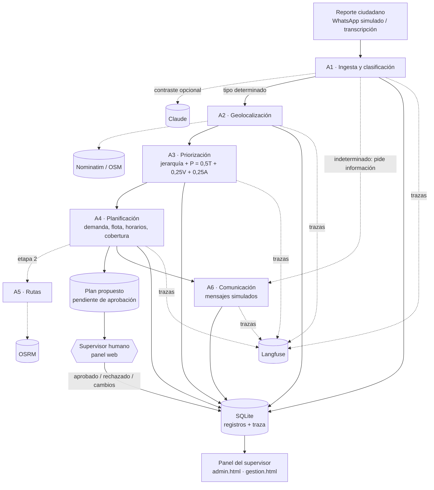

# Nombre del proyecto

<!-- Cambia el 0 por el número de su reto y deja la línea tal cual ("Reto: N"):
       1 = Agua · 2 = Educación · 3 = Empleabilidad
     No cambien de reto sin autorización de los organizadores. -->
Reto: 1

## Equipo

- Anyeline Arauz (@anyelinearauz-jpg)
- Analía Rodríguez (@leaniuwnm)
- Alanis Martez (@Ali-SMgt)

## Problema

El crecimiento urbano acelerado de Panamá Oeste, concentrado en distritos como Arraiján y La Chorrera, ha sobrepasado significativamente la capacidad operativa de las plantas potabilizadoras y las redes de distribución existentes. Frente a labores de mantenimiento, fallas tubulares o periodos de baja producción, comunidades enteras sufren desabastecimiento prolongado de agua potable por días, dependiendo de la distribución a través de carros cisterna. 

 
Actualmente, los reclamos y reportes llegan de forma dispersa mediante WhatsApp, redes sociales y llamadas telefónicas, careciendo de un centro de consolidación e inteligencia de datos. Esto genera: 


Redundancia no gestionada: Un mismo incidente es reportado cientos de veces. 

Invisibilidad de sectores vulnerables: Zonas con menor penetración digital o redes sociales quedan excluidas de la atención. 

Asignación inequitativa e ineficiente: Se prioriza a quienes generan mayor presión mediática o protestas, en lugar de atender criterios de prioridad crítica (como Centros de Salud, asilos/hogares de adultos mayores o escuelas). 

Incertidumbre social: La desinformación sobre los horarios de distribución fomenta cierres de calles y desconfianza institucional. 

Los afectados son la población de las zonas que pierden suministro de agua potable.

## Arquitectura de agentes

AquaAlerta es un centro de coordinación multiagente para la crisis del agua en Panamá Oeste. Recibe reportes ciudadanos (simulados de WhatsApp o transcripciones de audio), los convierte en afectaciones estructuradas, las ubica, las prioriza y propone un plan de abastecimiento con cisternas. **Ningún plan se ejecuta sin la aprobación de un supervisor humano.**

La coordinación usa **AutoGen** (`autogen-core`): cada agente es un `RoutedAgent` con contratos de entrada y salida tipados con Pydantic. Los agentes no escriben en la base de datos; el orquestador valida cada salida, la guarda y deja traza.

### Agentes

| Agente | Qué hace | Herramientas |
| --- | --- | --- |
| **A1 · Ingesta y clasificación** | Clasifica el reporte (falta de agua, tubería rota, agua contaminada) por palabras clave (`#sinagua`, `#tuberiarota`, `#idaan`, formas habladas). Extrae la fecha del incidente, la ubicación reportada y las unidades afectadas. Detecta duplicados y activa la alerta sanitaria. | Reglas deterministas. **Claude** contrasta la clasificación; si discrepa, el caso va a revisión humana. |
| **A2 · Geolocalización** | Normaliza la ubicación y la asocia a un distrito y una comunidad del catálogo de La Chorrera y Arraiján. Declara la certeza (confirmada, aproximada, ambigua o no verificada) y nunca inventa coordenadas. | Catálogo territorial y **Nominatim (OpenStreetMap)**. |
| **A3 · Priorización** | Aplica la jerarquía hospital → policlínica → centro de salud → escuela → resto. Para el resto calcula `P = 0,50·T + 0,25·V + 0,25·A`. Si falta un factor, P queda incompleto y se pide revisión; nunca se asigna cero. | Funciones deterministas. |
| **A4 · Planificación de recursos** | Calcula la demanda en galones/día × (duración del tipo + 50 % de los días sin agua). Asigna cisternas de la flota de 71 según el horario y calcula la cobertura: 100 % es ordinaria, 80–99 % parcial y menos de 80 % extraordinaria. | Funciones deterministas. Flota y horarios configurables. |
| **A5 · Rutas** *(reglas listas, aún fuera del flujo)* | Recorrido salida → carga → afectaciones → regreso, con límite de 1.000 km y excepción de emergencia aprobada por el supervisor. | **OSRM**. |
| **A6 · Comunicación** | Redacta los mensajes para quien reportó a partir de los registros: estado, cobertura parcial y datos faltantes. Nunca promete entregas ni horas. | Mensajería **simulada**. El adaptador de WhatsApp Cloud API está listo, con el envío bloqueado. |

### Punto de intervención humana

El **supervisor** es una función de control, no un agente. Desde el panel web (`gestion.html`) aprueba, rechaza o pide cambios en cada plan:

- Todo plan necesita aprobación, incluso con cobertura del 100 %.
- Una cobertura menor al 80 % exige justificación escrita.
- Aprobar no significa ejecutar: «ejecutado» lo registra solo el responsable operativo.
- Mientras no haya autenticación, las decisiones del panel se registran como **simuladas**.

Además pasan a revisión humana: las ubicaciones ambiguas, las categorías inciertas (p. ej. «clínica»), los empates persistentes, los reportes contradictorios y los desacuerdos entre Claude y las reglas.

### Diagrama


**Flujo**
El reporte entra por la CLI (demo) o por la API (POST /api/incidents).
A1 → A2 → A3 → A4 → A6 se ejecutan en secuencia dentro del runtime de AutoGen. Los reportes indeterminados se quedan en A1 y A6 pide más información.
Cada salida se guarda en SQLite con su traza: agente, versión de reglas y modelo usado.
El panel consulta la API y el supervisor decide cada plan.
Si está activado, cada ejecución se envía a Langfuse como una traza con una observación por agente y las llamadas a Claude como generation.

Muestra de un trace de flujo en langfuse: https://us.cloud.langfuse.com/project/cmvbbi8a300a3ad0jtsd3jl7b/traces/6aafea4690ff69a22ff1bf5338f434be?observation=f60deffb61060677

**Metodologia del Proyecto**
[Metodologia Proyecto Hackathon FISC equipo04.docx](https://github.com/user-attachments/files/33599550/Metodologia.Proyecto.Hackathon.FISC.equipo04.docx)

## Tecnologías y fuentes de datos
Tecnologías

Backend: Python 3.14 con uv.
Agentes: AutoGen 0.7.5 (autogen-core).
Contratos y configuración: Pydantic y pydantic-settings.
Base de datos: SQLAlchemy sobre SQLite (migrable a PostgreSQL).
API: FastAPI + Uvicorn (local).
Modelo de IA: Claude (claude-sonnet-5-5) a través de Claude Code, sin API key. El proveedor es intercambiable: Anthropic API, OpenAI o Ollama.
Mapas: Leaflet 1.9.4 con teselas de OpenStreetMap.
Geocodificación: Nominatim. Rutas: OSRM (etapa 2).
Observabilidad: Langfuse (SDK 5, OpenTelemetry).
Preparados sin activar: WhatsApp Business Cloud API, Whisper local (faster-whisper) y Google Speech-to-Text.
Pruebas: pytest (112 pruebas sin red).
Frontend: HTML, CSS y JavaScript.

Fuentes de datos

Reportes: simulados en data/simulados/reportes.json, con contactos ficticios sim:*. No se usan datos reales de ciudadanos.

Reglas operativas: docs/AGENT_CRITERIA_AND_DECISION_RULES.md (rev.4) y las decisiones de docs/DECISIONS.md. 

Incluyen la demanda de referencia (79,3 gal/persona urbana, 26,4 rural, 4 por estudiante y valores fijos para salud), los promedios de ocupación, la flota de 71 cisternas (Small 3.000–5.500 gal, Big 9.000–13.000 gal) y los horarios de disponibilidad.
Territorio: distritos de Panamá Oeste y corregimientos de La Chorrera y Arraiján (services/territorio.py).
Cartografía: OpenStreetMap, vía Nominatim y las teselas de OSM.

## Instalación y ejecución
Requisitos: Windows, macOS o Linux con uv y Git. uv instala Python por su cuenta.

Instalar dependencias:
git clone https://github.com/HackathonFISC/equipo-04.git
cd equipo-04
uv sync
Configurar. Copia .env.example a .env. Sin cambiar nada funciona en modo simulado, sin claves:
Reglas sin IA.
Mensajería simulada.
Sin geocodificación.
Para activar servicios (todos opcionales y sin claves reales en el repo):

Claude sin API key: MODEL_PROVIDER=claude_code y MODEL_NAME=claude-sonnet-5-5. Requiere la app de escritorio de Claude con la sesión iniciada.
Coordenadas reales: GEOCODER_PROVIDER=nominatim y NOMINATIM_USER_AGENT=nombre-app (correo@ejemplo).
Trazas: LANGFUSE_TRACING_ENABLED=true y las claves de tu proyecto de Langfuse.
Más detalle en docs/API_SETUP.md.

Cargar datos de demostración. --reiniciar vacía la base local de desarrollo:
uv run water-coordinator demo --reiniciar --sin-aprobacion
Iniciar la API (terminal 1):
```bash uv run uvicorn water_coordinator.api.app:app --reload --host 127.0.0.1 --port 8000 ```
Documentación interactiva: http://127.0.0.1:8000/docs

Iniciar el panel (terminal 2):
```bash uv run python -m http.server 5500 --bind 127.0.0.1 -d frontend ```
Abrir http://127.0.0.1:5500/admin.html y http://127.0.0.1:5500/gestion.html. Abrirlos como archivo (file://) no funciona.

Pruebas y estado de las integraciones:
```bash uv run pytest -q ```
```bash uv run water-coordinator estado```

La API no tiene autenticación y está pensada solo para uso local (127.0.0.1). Las aprobaciones desde el panel se registran como simuladas y ningún mensaje se envía realmente.


## Evals

## Decisiones del supervisor (sobre los datos del CSV)

1. *Aprobación simulada.* El plan quedó «aprobado» y marcado como simulación de prueba. Se guardó una huella del plan, para saber exactamente qué versión se aprobó, y un evento con el estado anterior y el nuevo.
2. *Rechazo con motivo.* El plan quedó «rechazado» y se guardó el motivo («Ruta no viable»).
3. *Solicitud de cambios.* El plan quedó en «cambios solicitados».
4. *Decidir dos veces el mismo plan.* Se intentó rechazar un plan ya aprobado y el sistema lo bloqueó: el plan sigue aprobado.
5. *Aprobación real de un plan incompleto.* Bloqueada. Sin la ruta del Agente 5, un plan solo puede aprobarse como simulación.
6. *Aprobar un plan al que le faltan datos de demanda.* Bloqueada. Solo se puede decidir sobre planes que están pendientes de aprobación.
7. *Plan inexistente.* El sistema responde «No existe el plan» y no cambia nada.

## Integridad y panel

8. *Reingresar un reporte ya cargado.* Se intentó volver a meter REP-2026-001 con el texto alterado. El sistema lo rechazó y el original quedó intacto.
9. *Decisión desde el panel.* Al intentar forzar una aprobación real por la API, la respuesta fue un error (422). La decisión normal se aceptó, pero quedó registrada como simulada.
10. *El panel refleja las decisiones.* Los 42 incidentes aparecen con sus estados nuevos (aprobado, rechazado, cambios solicitados), y la respuesta no incluye textos originales ni contactos.

## Escenarios simulados

11. *Hospital frente a 20 casas.* El hospital queda primero (nivel 1 de la jerarquía), aunque su reporte llegó después.
12. *Agua contaminada en Guadalupe.* Se clasifica como agua contaminada y activa la alerta sanitaria.
13. *Emergencia más grande que la flota disponible* (15 edificios). La cobertura es del 77,06 %, así que el plan exige aprobación extraordinaria. Sin justificación se bloquea; con justificación se registra.
14. *La misma emergencia de día y de noche.* A las 10:00 se asignan 25 cisternas y se cubre el 77,06 %. A las 22:00 solo hay 10, todas subcontratadas, y se cubre el 30,83 %. Coincide con los horarios aprobados.
15. *Consulta irrelevante junto a un reporte real.* La pregunta «¿A qué hora abren la oficina?» queda como indeterminada y no genera plan. Los mensajes al ciudadano no prometen entrega ni hora de llegada.

Anoté los resultados en [testsresults.md](tests/testsresults.md).

## Bitácora de IA

| Parte del proyecto | Herramienta de IA | Qué hizo la IA | Qué se decidió o modificó a mano |
| --- | --- | --- | --- |
| Documento de criterios y reglas de decisión (`docs/AGENT_CRITERIA_AND_DECISION_RULES.md`, rev.4) | ChatGPT | Redactó la especificación de los 6 agentes, sus reglas, estados y matriz de autonomía a partir de los requisitos del equipo. | El equipo respondió las preguntas de diseño y confirmó o descartó reglas (DEC-01 a DEC-27). Se copió al repo sin cambios. |
| Estructura del repositorio y documentación base (`docs/`, `.env.example`, `.gitignore`, `CLAUDE.md`) | Claude Code (Claude Opus) | Creó la estructura `src/`, la documentación inicial y la configuración segura sin secretos. | El README lo mantiene el equipo a mano; la IA no lo editó. |
| Decisiones de negocio posteriores (DEC-C01 a DEC-C16) | — (equipo) | La IA propuso las fórmulas de V y A y la escala de confianza cuando se le pidió «a su discreción», y señaló conflictos (C-01 a C-03). | La usuaria decidió: redondeo a 0,5, flota de 71 (10/5 propias, 40/16 subcontratadas), horarios, capacidades por tipo, la compensación del 50 % del tiempo sin agua en la demanda y la cobertura mínima del 80 %. |
| Sistema multiagente (A1–A4, A6), orquestación AutoGen, reglas deterministas, persistencia, adaptadores, CLI | Claude Code | Implementó el código, los datos simulados y las pruebas automatizadas (112 aprobadas). | Las reglas siguen el documento rev.4 y las decisiones del equipo. Los conflictos con el documento se consultaron antes de aplicarse. |
| Palabras clave (`docs/KEYWORDS.md`) | Claude Code | Amplió la lista con formas habladas y regionalismos panameños («pluma», «botando agua», «idan»). | El equipo definió los hashtags base: `#idaan`, `#sinagua`, `#faltadeagua`, `#tuberiarota`. |
| Diseño del frontend (`frontend/`: páginas, CSS, imágenes) | Herramienta no registrada en el repo (completar por el equipo) | — | Diseño visual del equipo (PR #1). |
| Conexión del frontend con la API, estadísticas, mapa Leaflet, comunidades, FAQ | Claude Code | Escribió el JavaScript (`js/api.js` y los scripts de las páginas) y la API FastAPI, conservando el diseño. Se verificó con capturas antes y después. | El equipo aprobó cada cambio visual (bloque FAQ, filtros con estados reales). El CSS no se modificó. |
| Observabilidad con Langfuse | Claude Code con la skill oficial `langfuse` (github.com/langfuse/skills) | Instrumentó las trazas siguiendo la guía de buenas prácticas, envió trazas reales y las auditó dos veces, corrigiendo lo detectado. | La usuaria creó el proyecto de Langfuse y puso las claves en `.env`. |
| Clasificación con IA en tiempo de ejecución | Claude (`claude-sonnet-5-5`) vía Claude Code | Contrasta la clasificación del Agente 1. Solo interpreta texto; si discrepa de las reglas, el caso va a revisión humana. | La usuaria decidió no usar créditos de la API: se usa la sesión de la app de escritorio (proveedor `claude_code`). |
| Grafo del código (`graphify-out/`) | Skill graphify (extracción AST, sin LLM) | Generó el mapa de módulos, dependencias y comunidades del código. | — |

**Revisión humana:** todo commit se hizo con autorización explícita de la usuaria. Ninguna credencial, dato personal real ni envío externo pasó por la IA. Las aprobaciones de planes desde el panel quedan marcadas como simuladas.

[Bitacora_de_prompts_equipo04 ChatGPT.docx](https://github.com/user-attachments/files/33598646/Bitacora_de_prompts_equipo04.ChatGPT.docx)

# BITÁCORA DE DESARROLLO — PROYECTO AQUAALERTA PANAMÁ OESTE

*Fecha:* 17 de octubre de 2026  
*Ubicación de trabajo:* D:\DS4.2  
*Responsable:* Asistente de desarrollo (OpenCode)  
*Estado:* Completado — entregables listos en carpetas separadas

---

## 1. ANÁLISIS Y CONFIGURACIÓN DEL ENTORNO

| Acción | Detalle |
|--------|---------|
| Requerimiento | Desarrollar plataforma web completa "AquaAlerta Panamá Oeste" para gestión de interrupciones de agua potable en Arraiján y La Chorrera, Panamá. |
| Entorno inicial | Windows (PowerShell) sin Node.js instalado. |
| Instalación | Node.js LTS v24.20.0 mediante winget. |
| Verificación | node --version → v24.20.0; npm.cmd --version → 11.19.0. |

---

## 2. PROYECTO REACT (STACK COMPLETO)

*Ruta:* D:\DS4.2\aquaalerta

### Stack utilizado
- React 19 + TypeScript
- Vite 8.3.4
- Tailwind CSS 3.4.19
- Lucide React (iconos)
- Recharts (gráficos)
- React Router DOM 7.18.4
- Leaflet + react-leaflet (mapas OpenStreetMap)
- React Hook Form + Zod (formularios y validación)
- Supabase JS (autenticación y base de datos, opcional)

### Archivos creados

| Ruta | Contenido |
|------|-----------|
| tailwind.config.js | Paleta de colores (#071019, #0FC8BB, #7139C8), animaciones, tipografía Inter |
| src/index.css | Estilos base, glassmorphism, partículas, scrollbar |
| src/lib/utils.ts | Utilidades de fechas, códigos de seguimiento, formato |
| src/lib/supabase.ts | Cliente Supabase y detección de configuración |
| src/types/index.ts | Modelo de datos (usuarios, comunidades, incidencias, reportes, cisternas, programaciones, auditoría) |
| src/config/catalogs.ts | Catálogos de distritos, corregimientos y tipos de incidencia |
| src/services/api.ts | Capa de datos con Supabase + fallback localStorage (sin datos falsos) |
| src/components/ui/ | Button, Input, Select, TextArea, Card, Badge, Skeleton, EmptyState, StatCard, Toast, ToastList |
| src/components/layout/ | Logo, Header (menú persistente), Footer, Sidebar (admin) |
| src/hooks/useAuth.ts | Autenticación, roles (admin/operator/public), cierre de sesión |
| src/pages/ | Home, Communities, Report, Tracking, Cisterns, Statistics, Info, Login, Admin |
| src/App.tsx | Rutas públicas, privadas (/admin/*), autenticación requerida |
| tsconfig.app.json | Configuración con alias @/ → ./src/* |
| vite.config.ts | Alias Vite para resolver @/ en servidor de desarrollo |
| .env.example | Variables de entorno de ejemplo (sin credenciales reales) |
| README.md | Instrucciones de instalación y ejecución |

### Comandos ejecutados
- npm create vite@latest aquaalerta -- --template react-ts
- npm install tailwindcss postcss autoprefixer lucide-react recharts react-router-dom framer-motion clsx tailwind-merge leaflet react-leaflet date-fns zod react-hook-form @hookform/resolvers @supabase/supabase-js
- npm install -D @types/react-leaflet @types/leaflet typescript @types/node
- npx tailwindcss init -p
- npx tsc --noEmit -p tsconfig.app.json → *0 errores*
- npm run build → *Build exitoso en dist/* (solo advertencia de tamaño de chunk > 500 kB)

---

## 3. SITIO WEB ESTÁTICO (HTML/CSS/JS PURO)

*Ruta:* D:\DS4.2\aquaalerta-web

### Páginas (8)
| Archivo | Descripción |
|---------|-------------|
| index.html | Inicio con hero, tarjetas informativas y navegación |
| comunidades.html | Buscador, filtros, mapa simulado, listado y panel de detalle |
| reportar.html | Formulario con validación Zod-like, campos opcionales, código de seguimiento |
| seguimiento.html | Consulta de estado por código de seguimiento |
| cisternas.html | Programación de distribución, KPIs y tabla de entregas |
| estadisticas.html | Dashboard con tarjetas y gráficos de barras CSS |
| informacion.html | Acerca de, FAQ, formulario de contacto |
| login.html | Inicio de sesión con mostrar/ocultar contraseña |

### Archivos de soporte
- css/style.css — Estilos unificados para todas las páginas
- js/main.js — Menú móvil, partículas, scroll suave, toasts
- js/comunidades.js, js/reportar.js, js/seguimiento.js, js/cisternas.js, js/estadisticas.js

---

## 4. REFACTORIZACIÓN DEL PANEL ADMIN (PROMPT MEJORADO)

Se reescribió src/pages/Admin.tsx siguiendo el segundo prompt del usuario, agregando:

- *Acceso protegido:* login primero, rutas /admin/* requieren autenticación (rol admin/operator).
- *Dashboard General:* KPIs de reportes, comunidades, cisternas, pendientes; estatus de contrataciones (pendiente, aprobado, activo, cerrado); seguimiento de trayectos y envíos (en ruta, completado, con retraso, cancelado).
- *Módulo de Entregas de Agentes:* tabla modular con nombre del agente, fecha/hora, tipo de entrega, evidencia, estado de revisión (aprobado/pendiente/rechazado), filtros por fecha/agente/estado, exportación CSV.
- *Módulo de Seguimiento de Reportes de Agua:* KPIs (total, pendientes, resueltos, urgencia crítica), indicadores de urgencia por colores (rojo crítica, amarillo media, verde normal), lista organizada.
- *Buscador general y filtros rápidos* en gestión de reportes y seguimiento.
- *Exportación de datos* (botón CSV visible).
- *Footer único, limpio y al final.*

---

## 5. SITIO ESTÁTICO MEJORADO (8 PÁGINAS)

*Ruta:* D:\DS4.2\aquaalerta-sitio-web

### Páginas
| Archivo | Descripción |
|---------|-------------|
| index.html | *Primera pantalla:* Inicio de sesión (login) |
| admin.html | Panel de administración con actividades en barra superior |
| reportes.html | Gestión de reportes con botón Descargar CSV |
| comunidades.html | Comunidades afectadas con buscador y filtros |
| mapa.html | Mapa geográfico provisional |
| tracking.html | Seguimiento de reportes con urgencia por colores |
| estadisticas.html | Dashboard estadístico |
| configuracion.html | Configuración, privacidad, formulario contacto |

### Características
- Todas las páginas comparten el mismo header, footer y cuerpo (secuencia consistente).
- Diseño responsivo (móvil, tableta, escritorio).
- Menú desplegable en pantallas pequeñas.
- Botón de descarga CSV en gestión de reportes.
- Paleta y estilo idénticos al proyecto React.

---

## 6. SITIO ADMIN SIMPLE (3 PÁGINAS)

*Ruta:* D:\DS4.2\aquaalerta-admin-simple

Solicitado por el usuario para reducir complejidad y evitar problemas de display en múltiples páginas.

| Archivo | Descripción |
|---------|-------------|
| index.html | *Primera pantalla:* Inicio de sesión (coincide con diseño solicitado: logo, correo, contraseña, mostrar/ocultar, Recordarme, ¿Olvidaste tu contraseña?, botón turquíso) |
| admin.html | Panel con *actividades del administrador en la parte superior* (píldoras navegables: Dashboard, Reportes, Comunidades, Mapa, Tracking, Estadísticas, Configuración) |
| gestion.html | *Gestión unificada en pestañas:* Reportes (con buscador, filtros, descarga CSV), Comunidades, Mapa, Tracking, Estadísticas, Configuración — todo en una sola página |

### Archivos de soporte
- css/style.css — Hoja de estilos única para las 3 páginas
- js/main.js — Menú móvil, partículas, toasts, lógica de pestañas y formularios

### Mejoras de diseño implementadas
- Barra superior de actividades con scroll horizontal en móviles (evita desbordamiento).
- Tarjetas y tablas con overflow-x-auto para evitar desplazamiento horizontal roto.
- Menú hamburguesa funcional en celulares.
- KPIs apilados en columna en móviles.
- Animaciones discretas (partículas, fade-in, float) sin afectar legibilidad.

---

## 7. RESUMEN DE ENTREGABLES POR CARPETA


D:\DS4.2\aquaalerta/               → Proyecto React completo (Vite + TS + Tailwind + Supabase opcional)
D:\DS4.2\aquaalerta-web/           → Sitio estático de 8 páginas (HTML/CSS/JS)
D:\DS4.2\aquaalerta-sitio-web/     → Sitio estático mejorado de 8 páginas (misma identidad)
D:\DS4.2\aquaalerta-admin-simple/  → Sitio admin simple de 3 páginas (HTML/CSS/JS)


---

## 8. ESTADO FINAL

- ✅ TypeScript compila sin errores en el proyecto React.
- ✅ Build de producción generado en dist/.
- ✅ Sitios estáticos listos para abrir directamente en el navegador (sin npm install).
- ✅ Todas las páginas mantienen la identidad visual de AquaAlerta (turquesa #0FC8BB, morado #7139C8, fondo azul marino #071019).
- ✅ No se inventan datos de demostración; se muestran estados vacíos cuando no hay registros.
- ✅ No se exponen credenciales ni claves API en el frontend.
- ✅ Contraseñas no se almacenan en texto plano (auth vía Supabase o simulado localmente).

---

---

Entrega: tag de git `final-24h` sobre el último commit válido, al cumplirse la hora 24.
Terminado en entrega 12:40PM
