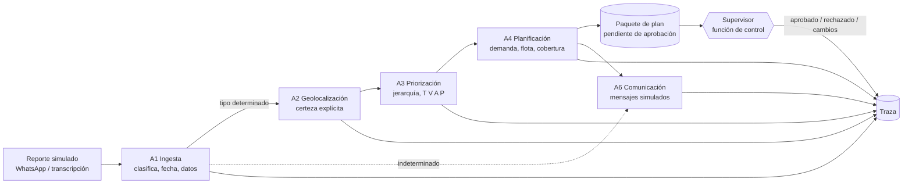

# Arquitectura (fase de construcción)

Las reglas funcionales vienen de [AGENT_CRITERIA_AND_DECISION_RULES.md](AGENT_CRITERIA_AND_DECISION_RULES.md). Lo que el documento marca como `[PROP]` y se implementó aquí aparece como supuesto en [DECISIONS.md](DECISIONS.md).

## Flujo implementado (etapa 1)

- **Orquestación:** `orchestration/pipeline.py` usa `SingleThreadedAgentRuntime` de AutoGen. Cada agente es un `RoutedAgent` con un único `message_handler` tipado: los contratos de entrada y salida son modelos pydantic de `schemas/models.py`.
- **Escritura en la base:** los agentes **no escriben** en la base de datos ni modifican la salida de otro agente. El orquestador valida cada salida, la persiste y registra un evento con el agente, la versión de reglas y el modelo de IA usado.
- **Agente 5 (rutas):** sus reglas (`services/rutas.py`) y el adaptador OSRM ya existen, pero **no entra en el flujo de la etapa 1**. Falta la ubicación de la organización ([PEND]). Por eso todo plan queda `completo=False` y solo admite aprobación simulada.
- **Supervisor:** es una función de control, no un séptimo agente (`services/aprobacion.py`). Registra quién decidió, qué, cuándo, la huella sha256 del plan y la versión de reglas. Nunca marca nada como *ejecutado*.

## Separación de responsabilidades

| Capa | Ruta | Contenido |
| --- | --- | --- |
| Contratos | `schemas/models.py` | Modelos pydantic: reporte, registro, ubicación, prioridad, cisterna, demanda, plan, decisión y mensaje. |
| Reglas deterministas | `services/` | `clasificacion`, `fechas`, `prioridad` (T, V, A, P, orden), `demanda` (demanda y cobertura), `flota` (71 cisternas y horarios), `rutas`, `aprobacion`, `parametros` (valores aprobados con su origen), `monitoreo`. |
| Agentes | `agents/` | `ingesta` (A1), `geolocalizacion` (A2), `priorizacion` (A3), `planificacion` (A4), `comunicacion` (A6). Llaman a las reglas; la IA solo interpreta texto (A1). |
| Adaptadores | `tools/` | `llm`, `geocoding`, `routing`, `messaging`, `transcription`, `storage` y `estado`. Cada uno tiene una interfaz `Protocol`, su implementación y una función `estado()` que informa `NOT_CONFIGURED`, `CONFIGURED`, `CONNECTED`, `ERROR` o `DISABLED`. |
| Persistencia | `persistence/repository.py` | SQLAlchemy Core. Tabla `documentos` con el estado actual en JSON; tabla `eventos` con la traza, solo de adición. Los reportes originales son inmutables. |
| Configuración | `config.py`, `.env` | pydantic-settings. Los secretos usan `SecretStr`. |
| Entrada | `main.py` | CLI: `demo`, `aprobar`, `estado`, `traza`. |
| API | `api/` | Vacía: framework de API no aprobado. |

## Dónde interviene la IA y dónde no

- **Con IA (opcional):** el Agente 1 contrasta la clasificación con el modelo configurado. Si el modelo discrepa, no sobrescribe: baja la confianza y envía el registro a revisión.
- **Sin IA (siempre deterministas):** prioridad, demanda, cobertura, asignación de cisternas, horarios, clasificación de rutas, aprobación y mensajes del Agente 6. Los mensajes del Agente 6 salen de plantillas: no hay redacción con IA para evitar promesas no registradas.

## Trazabilidad

Cada ejecución registra:
- el reporte original (inmutable);
- el registro del Agente 1, con texto original, datos extraídos, faltantes, evidencia y confianza;
- la ubicación, con la certeza y su fuente;
- la prioridad, con factores, explicación, faltantes y rango;
- el plan, con fórmulas, bases, supuestos, cisternas y riesgos;
- los mensajes simulados y su "envío";
- la decisión del supervisor, con su huella.

Todo lleva `version_reglas = criterios-1.0-rev.4+construccion-2026-10-17`. Para consultarlo: `uv run water-coordinator traza <id>`.

## Grafo del código (graphify)

`graphify-out/` contiene un grafo del código de `src/water_coordinator`, generado con graphify 0.9.82 el 2026-10-17. Fue una extracción AST, sin LLM y sin costo de tokens.

| Archivo | Uso |
| --- | --- |
| `graphify-out/graph.html` | Grafo interactivo; se abre en el navegador. |
| `graphify-out/GRAPH_REPORT.md` | Informe: nodos centrales, conexiones inesperadas y comunidades. |
| `graphify-out/graph.json` | Datos del grafo. |

**Resultados:** 347 nodos, 699 aristas, 19 comunidades y ningún ciclo de importación.

**Nodos más conectados:**
- `procesar()`: graphify fusiona en un solo nodo el orquestador y los `procesar` de cada agente, porque comparten nombre.
- `Settings`.
- `RegistroAfectacion`.
- `registrar()`.
- `AgenteIngesta`.
- `Repositorio`.
- `planificar()`.

**Comunidades principales:**
- Reglas de prioridad T/V/A/P.
- Clasificación por palabras clave.
- Flota y horarios.
- Logs y redacción de secretos.
- Geocodificación.
- Transcripción.
- Agentes AutoGen.
- Comunicación (A6).
- CLI y configuración.

**Aviso de salud del grafo:** 146 aristas apuntan a símbolos externos (bibliotecas como pydantic o autogen) y 70 aristas se colapsaron entre pares de nodos repetidos. Es esperable en una extracción solo AST; el grafo sirve para navegar, pero no es un análisis exhaustivo.

**Actualización:** tras cambiar el código, ejecutar `/graphify src/water_coordinator --update` (re-extrae solo lo modificado). Las cachés y rutas locales de `graphify-out/` están en `.gitignore`.

## Pendiente de diseño

- Agente 5 dentro del flujo, cuando estén la ubicación de la organización, los puntos de carga y la autonomía.
- Backend HTTP (webhook de WhatsApp, interfaz del supervisor): falta aprobar el framework.
- Integración de Leaflet en `frontend/`.
